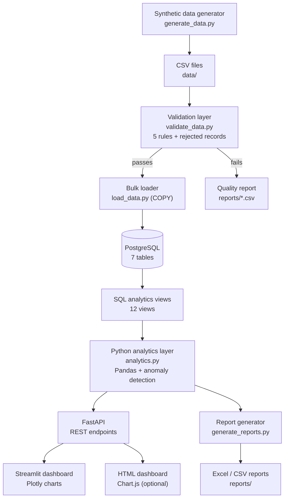
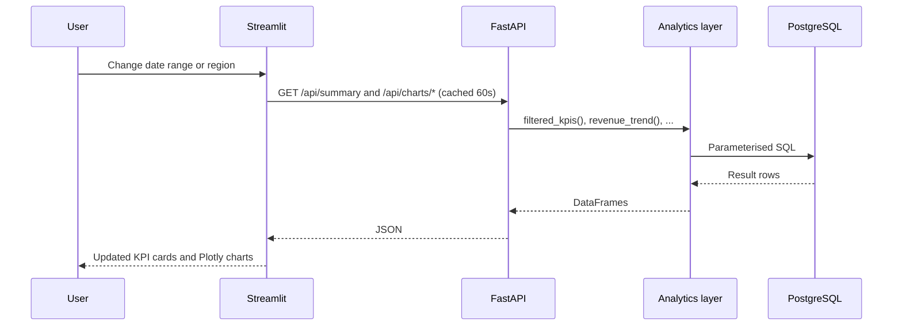
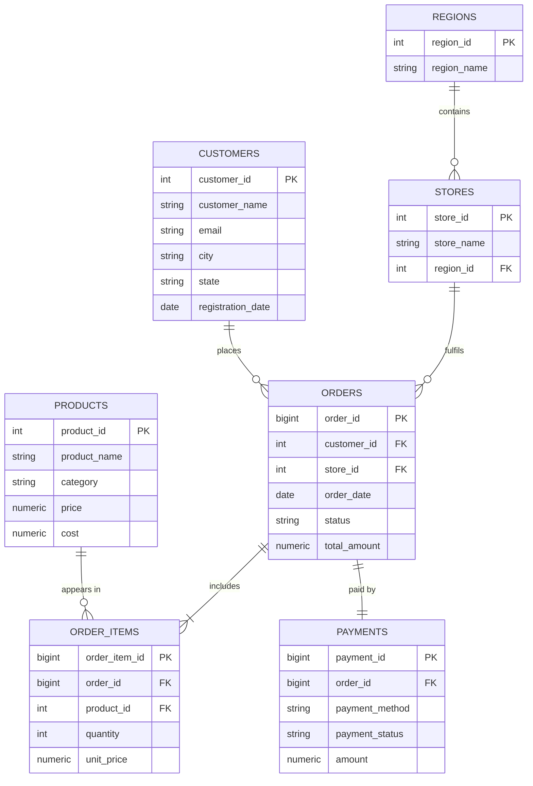
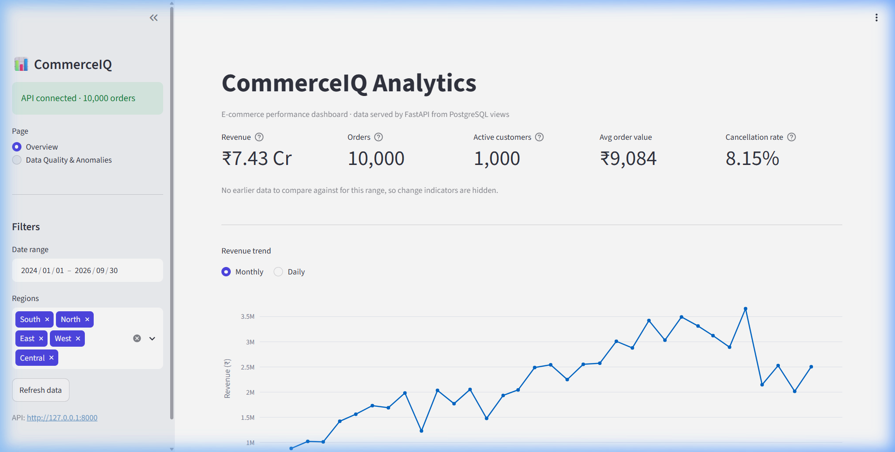
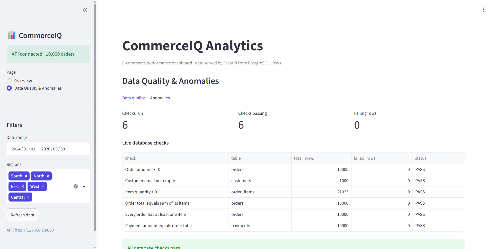

# CommerceIQ

**An end-to-end e-commerce analytics platform: data generation, validation, DuckDB/PostgreSQL storage, SQL analytics views, a FastAPI backend, a Streamlit + Plotly dashboard, and automated Excel/CSV reporting.**


---

## Table of contents

1. [Overview](#overview)
2. [Business problem](#business-problem)
3. [Key features](#key-features)
4. [Architecture](#architecture)
5. [Data model](#data-model)
6. [Tech stack](#tech-stack)
7. [Project structure](#project-structure)
8. [Getting started](#getting-started)
9. [Pipeline walkthrough](#pipeline-walkthrough)
10. [Data validation](#data-validation)
11. [SQL analytics views](#sql-analytics-views)
12. [API reference](#api-reference)
13. [Dashboard](#dashboard)
14. [Anomaly detection](#anomaly-detection)
15. [Automated reports](#automated-reports)
16. [Design decisions](#design-decisions)
17. [Performance](#performance)
18. [Known limitations](#known-limitations)
19. [Roadmap and suggested additions](#roadmap-and-suggested-additions)
20. [Troubleshooting](#troubleshooting)

---

## Overview

CommerceIQ replaces the manual "download Excel, build a report" routine of a fictional e-commerce company with an automated pipeline. It generates 1M+ order records, validates them, loads them into DuckDB for local demos or PostgreSQL for database-backed deployments, exposes business metrics through 12 SQL views, serves them over a REST API, and presents them in an interactive dashboard. Excel and CSV reports can be regenerated with one command.

> **About the data:** the dataset is **synthetic**, produced by `src/generate_data.py` with a fixed random seed. This gives full control over volume and quality, and lets the validation layer be proven against known, planted errors.

## Business problem

Management wants answers to questions such as:

| Question | Where it is answered |
|---|---|
| How much did we sell? | `v_kpi_summary`, `/api/kpis`, KPI cards |
| Which products sell the most? | `v_top_products`, Top products chart |
| Which region generates the most revenue? | `v_region_revenue`, Region chart |
| Which customers are most valuable? | `v_top_customers`, `/api/customers/top` |
| How many orders are cancelled? | `v_order_status`, Cancellation rate card |
| What is the average order value? | `v_kpi_summary`, AOV card |
| Is the data trustworthy? | Data Quality page, `data_quality_report.csv` |

**Metric definition:** *revenue* always means the sum of `total_amount` over `COMPLETED` orders. This is applied consistently in every view, query and API endpoint.

## Key features

- **Realistic data generation:** 100K customers, 10K products, 1M orders (about 2.2M order lines), skewed product popularity, consistent order totals, and order dates that never precede customer registration.
- **Validation layer:** five rules run on the CSVs before loading, with a rejected-records file and a non-zero exit code on failure. A fault-injection script proves the rules work.
- **Fast bulk loading:** PostgreSQL `COPY`, parent tables before children.
- **12 SQL analytical views:** CTEs, window functions (`LAG`, `SUM() OVER`), `FILTER` aggregates.
- **FastAPI backend:** typed query parameters, validation (422 on bad input), pagination, CORS, interactive Swagger docs.
- **Streamlit + Plotly dashboard:** date and region filters, KPI cards with change versus the previous period, seven charts, and a data quality and anomalies page.
- **Anomaly detection:** rolling z-score on daily revenue and IQR on order values, with adjustable sensitivity.
- **Automated reporting:** a formatted 7-sheet Excel workbook plus CSV exports.
- **Optional standalone HTML dashboard:** Chart.js + Tailwind, reading the same API.

## Architecture

### High-level view



### Layers and responsibilities

| Layer | Component | Responsibility |
|---|---|---|
| Ingestion | `generate_data.py`, `load_data.py` | Produce and load source data |
| Quality | `validate_data.py`, `inject_bad_data.py` | Detect bad records before they reach the database |
| Storage | PostgreSQL (`schema.sql`) | Relational model with keys, constraints, indexes |
| Semantic | `views.sql` (12 views) | Single source of truth for business logic |
| Analytics | `analytics.py` | Read views into Pandas, filtered queries, anomaly detection |
| Service | `api/main.py` (FastAPI) | Validated, documented HTTP access to analytics |
| Presentation | `dashboard/app.py`, `html/dashboard.html` | Interactive visuals; no direct database access |
| Reporting | `generate_reports.py` | Scheduled-style Excel and CSV outputs |

### Request flow (one dashboard interaction)



## Data model



Order statuses: `COMPLETED`, `CANCELLED`, `RETURNED`, `PENDING`. Region is derived from the store that took the order.

## Tech stack

| Area | Technology |
|---|---|
| Language | Python 3.10+ |
| Database | DuckDB for local demos; PostgreSQL 14+ supported |
| Data processing | Pandas, NumPy, Faker |
| Database access | SQLAlchemy, psycopg2 |
| API | FastAPI, Uvicorn |
| Dashboard | Streamlit, Plotly Express |
| Optional web dashboard | Tailwind CSS, Chart.js (CDN) |
| Reporting | openpyxl (Excel), CSV |
| Configuration | python-dotenv |

## Project structure

```
commerceiq/
├── api/
│   └── main.py                 FastAPI application
├── dashboard/
│   ├── app.py                  Streamlit dashboard (2 pages)
│   └── api_client.py           Cached HTTP client for the API
├── html/
│   └── dashboard.html          Optional standalone dashboard
├── sql/
│   ├── schema.sql              Tables, keys, indexes
│   ├── queries.sql             Core business queries
│   └── views.sql               12 analytical views
├── src/
│   ├── init_db.py              Create database, tables, seed regions
│   ├── generate_data.py        Synthetic data generator (small / full)
│   ├── load_data.py            Bulk loader using COPY
│   ├── inject_bad_data.py      Plants known errors for validation tests
│   ├── validate_data.py        Five validation rules + reports
│   ├── run_queries.py          Runs sql/queries.sql with timings
│   ├── create_views.py         Creates and lists the views
│   ├── analytics.py            Analytics layer and anomaly detection
│   ├── test_analytics.py       Prints outputs, anomaly self-test
│   └── generate_reports.py     Excel and CSV report builder
├── docs/
│   └── talking_points.md       Interview preparation notes
├── data/                       Generated CSVs (git-ignored)
├── reports/                    Generated reports (git-ignored)
├── config.py                   Settings loaded from .env
├── check_setup.py              Verifies packages and DB connection
├── requirements.txt
└── .env                        Local settings (never commit real passwords)
```

## Getting started

### Prerequisites

- Python 3.10 or newer
- PostgreSQL 14 or newer only if `DB_ENGINE=postgres`; local demos default to DuckDB
- About 2 GB of free RAM for the full 1M-order dataset (the `small` dataset needs far less)

### Installation

```bash
# 1. Create and activate a virtual environment
python -m venv venv
venv\Scripts\activate            # Windows
# source venv/bin/activate       # macOS / Linux

# 2. Install dependencies
pip install -r requirements.txt

# 3. Configure local settings
copy .env.example .env             # Windows
# cp .env.example .env             # macOS / Linux
# Edit .env if you want PostgreSQL, API auth, or custom CORS origins

# 4. Verify the setup
python check_setup.py
```

Configuration keys in `.env`:

| Key | Default | Meaning |
|---|---|---|
| `ENVIRONMENT` | `development` | Set to `production` to require `API_KEY` |
| `DB_ENGINE` | `duckdb` | Use `duckdb` for local demos or `postgres` for PostgreSQL |
| `DB_HOST` | `localhost` | PostgreSQL host |
| `DB_PORT` | `5432` | PostgreSQL port |
| `DB_NAME` | `commerceiq` | Database name (created automatically) |
| `DB_USER` | `postgres` | Database user |
| `DB_PASSWORD` | (set this) | Database password |
| `API_URL` | `http://127.0.0.1:8000` | Where the dashboard finds the API |
| `API_KEY` | empty | If set, API requests must send `X-API-Key` |
| `CORS_ORIGINS` | local Streamlit origins | Comma-separated browser origins allowed to call the API |

## Pipeline walkthrough

Run from the project root with the virtual environment active.

```bash
python src/init_db.py                      # 1. create database and tables
python src/generate_data.py --scale small  # 2. quick test dataset (10K orders)
python src/validate_data.py                # 3. validate CSVs
python src/load_data.py                    # 4. load into PostgreSQL
python src/create_views.py                 # 5. create the 12 views
python src/run_queries.py                  # 6. run the core business queries
python src/test_analytics.py               # 7. test the analytics layer
python src/generate_reports.py             # 8. build Excel and CSV reports
```

For the full dataset, replace step 2 with `python src/generate_data.py --scale full` and re-run steps 3 and 4 (the loader clears existing data first).

| Scale | Customers | Products | Stores | Orders |
|---|---|---|---|---|
| `small` | 1,000 | 200 | 10 | 10,000 |
| `full` | 100,000 | 10,000 | 50 | 1,000,000 |

### Run the application

Open two terminals in the project root:

```bash
# Terminal 1: API
uvicorn api.main:app --reload

# Terminal 2: dashboard
streamlit run dashboard/app.py
```

| Service | URL |
|---|---|
| Streamlit dashboard | http://localhost:8501 |
| API documentation (Swagger) | http://127.0.0.1:8000/docs |
| Optional HTML dashboard | open `html/dashboard.html` in a browser (API must be running) |

### Docker

The Docker image builds a small DuckDB demo database during image creation, so it can start from a clean clone.

```bash
docker compose up --build
```

For a public deployment, set `ENVIRONMENT=production`, set a strong `API_KEY`, and set `CORS_ORIGINS` to the dashboard origin.

## Data validation

Validation runs on the CSV files **before** loading, because the database schema's constraints would otherwise reject the whole load at the first bad row.

| Rule | Table | Check |
|---|---|---|
| R1 | orders | `total_amount >= 0` |
| R2 | orders | `customer_id` exists in customers |
| R3 | customers | `email` is not empty |
| R4 | order_items | `quantity > 0` |
| R5 | orders | no duplicate `order_id` |

Outputs: `reports/data_quality_report.csv` (per-rule summary) and `reports/rejected_records.csv` (every failing record key). The script exits with code `2` if any rule fails, so automation can stop a bad load.

**Proving the validator works:** `inject_bad_data.py` copies the clean files to `data/dirty/` and plants exactly 50 negative amounts, 40 orphan customer IDs, 30 empty emails, 25 zero quantities and 20 duplicate orders.

```bash
python src/inject_bad_data.py
python src/validate_data.py --source data/dirty   # expect 50 / 40 / 30 / 25 / 20 failures
```

The dashboard also runs six **live database checks**, including cross-table reconciliations: order total equals the sum of its items, every order has items, and payment amount equals order total.

## SQL analytics views

| # | View | Purpose |
|---|---|---|
| 1 | `v_kpi_summary` | Headline KPIs: revenue, orders, customers, AOV, cancellation rate |
| 2 | `v_monthly_revenue` | Revenue, orders and AOV by month |
| 3 | `v_daily_revenue` | Daily revenue for trends and anomaly detection |
| 4 | `v_top_products` | Units, revenue and profit per product |
| 5 | `v_category_performance` | Category revenue, profit and margin % |
| 6 | `v_region_revenue` | Revenue and share of total by region |
| 7 | `v_store_performance` | Revenue, orders and AOV per store |
| 8 | `v_top_customers` | Customer lifetime value and last order date |
| 9 | `v_customer_segments` | Customers grouped by order frequency |
| 10 | `v_order_status` | Order count and value per status |
| 11 | `v_payment_methods` | Share of paid payments by method |
| 12 | `v_monthly_growth` | Month-over-month growth using `LAG` |

## API reference

Base URL `http://127.0.0.1:8000`. Interactive docs at `/docs`. All endpoints are `GET`.

| Endpoint | Key parameters | Returns |
|---|---|---|
| `/health` | none | Database connectivity, order count, response time |
| `/api/kpis` | none | All-time headline KPIs |
| `/api/summary` | `start`, `end`, `regions` | KPIs for the range plus the previous equal-length period |
| `/api/revenue` | `granularity` (month/day), `start`, `end` | Revenue series and total |
| `/api/orders` | `status`, `start`, `end`, `limit`, `offset` | Paginated orders |
| `/api/orders/status` | none | Order status breakdown |
| `/api/products/top` | `n`, `by` (units_sold/revenue/profit) | Top products |
| `/api/customers/top` | `n` | Top customers by lifetime value |
| `/api/regions` | none | All-time revenue by region |
| `/api/categories` | none | All-time category performance |
| `/api/anomalies` | `z`, `window`, `iqr`, `limit` | Revenue anomalies and unusual orders |
| `/api/charts/revenue-trend` | `start`, `end`, `regions`, `granularity` | Filtered trend data |
| `/api/charts/top-products` | `start`, `end`, `regions`, `n`, `by` | Filtered top products |
| `/api/charts/regions` | `start`, `end`, `regions` | Filtered revenue by region |
| `/api/charts/categories` | `start`, `end`, `regions` | Filtered revenue by category |
| `/api/charts/status` | `start`, `end`, `regions` | Filtered status counts |
| `/api/quality` | none | Database checks and last CSV validation report |

Dates use `YYYY-MM-DD`; `regions` is a comma-separated list. Invalid values return HTTP `422`.

Example:

```bash
curl "http://127.0.0.1:8000/api/summary?start=2026-01-01&end=2026-03-31&regions=North,West"
```

## Dashboard

**Overview page**
- Sidebar filters: date range and regions
- Five KPI cards (revenue, orders, active customers, average order value, cancellation rate) with change versus the previous period of equal length
- Charts: revenue trend (monthly/daily), top 10 products (by units or revenue), revenue by region, revenue by category, order status

**Data Quality & Anomalies page**
- Live database checks and the latest CSV validation report
- Daily revenue chart with flagged days highlighted
- Table of the largest unusual orders, with sliders to adjust sensitivity

### Dashboard Screenshots

#### 1. Overview & Performance Trends


#### 2. Data Quality & Live Validation


## Anomaly detection

| Method | Applied to | Rule |
|---|---|---|
| Rolling z-score | Daily revenue | Compare each day to the mean and standard deviation of the previous 30 days (minimum 14); flag `|z| >= threshold` (default 3) as SPIKE or DROP |
| IQR fence | Completed order values | Flag orders above `Q3 + k × IQR` (default k = 3), thresholds computed in SQL |

`test_analytics.py` includes a self-test that plants a 5x spike and a zero-revenue day, then confirms both are detected. Because the generated data is statistically uniform, real anomalies are rare; this is expected.

## Automated reports

```bash
python src/generate_reports.py
```

| Output | Contents |
|---|---|
| `reports/monthly_sales_report.xlsx` | 7 sheets: Summary, Monthly Revenue (with chart), Regions, Categories, Top Products, Top Customers, Data Quality |
| `reports/product_performance.csv` | Every product with units, revenue, profit, margin % |
| `reports/data_quality_report.csv` | Per-rule validation summary |

The command overwrites previous outputs, so it can be scheduled with cron or Windows Task Scheduler.

## Design decisions

| Decision | Reason |
|---|---|
| Synthetic data with a fixed seed | Controlled volume and quality; reproducible results |
| `COPY` for loading | Orders of magnitude faster than row-by-row inserts |
| Validate before load | Reports every problem instead of failing on the first; enables automated gating |
| Business logic in SQL views | One definition of each metric for the API, dashboard and reports |
| API between database and UI | The UI holds no database credentials; other clients can reuse the endpoints |
| Parameterised SQL everywhere | Prevents SQL injection; user input is never concatenated into queries |
| 60-second dashboard cache | Keeps filtering responsive on 1M rows |
| Revenue = `COMPLETED` only | Cancelled, returned and pending orders do not inflate sales |

## Performance

Record your own measurements after a full-dataset run:

| Measurement | Result |
|---|---|
| Full data generation time | |
| `load_data.py` total time | |
| Slowest query (from `run_queries.py`) | |
| Dashboard filter change (uncached / cached) | |

Techniques used: indexes on join and filter columns, `ANALYZE` after load, aggregation pushed into SQL, and result caching in the dashboard.

## Known limitations

- Data is synthetic; business patterns (seasonality, customer churn) are not modelled.
- API key authentication is supported for public deployments, but there is no user or role model.
- CORS is environment-configurable; production deployments must set the exact dashboard origin.
- The automated test suite covers validation and anomaly logic plus API-key enforcement, but not every dashboard interaction.
- Filtered endpoints scan the `orders` table on each uncached request.
- Dashboard anomaly detection ignores the sidebar filters.
- Currency is shown in INR with Indian-style compact units (L, Cr).

## Roadmap and suggested additions

Ordered by value for a portfolio project.

### High priority
1. **Screenshots and a short demo GIF** in the README. This is the single biggest improvement to first impressions.
2. **Automated tests (pytest):** unit tests for validation rules and anomaly detection, API tests with FastAPI's `TestClient`, and a SQL reconciliation test (revenue by region sums to total revenue).
3. **Rate limiting and structured request logging** for public API deployments.
4. **End-to-end dashboard tests** with Playwright or Streamlit testing tools.
5. **Materialized views or pre-aggregated tables** for the heaviest queries, refreshed after each load.

### Medium priority
6. **Incremental loads and a run log:** track each pipeline run (rows loaded, rejected, duration) in a table.
7. **Cohort and retention analysis:** customer cohorts by registration month; repeat-purchase rate.
8. **Product and basket analytics:** top product pairs bought together; ABC classification.
9. **Forecasting:** a simple monthly revenue forecast (for example seasonal naive or Holt-Winters) shown on the trend chart.
10. **Pipeline orchestration:** a single `make` or `run_pipeline.py` command, or an Airflow/Prefect DAG.
11. **API authentication** (API key or JWT) and tightened CORS.
12. **Data quality framework:** replace hand-written rules with Great Expectations or Pandera.

### Nice to have
13. **Row-level seasonality** in the generator (festival peaks, weekday effects) so anomaly detection has realistic signal.
14. **PDF executive summary** generated alongside the Excel report.
15. **Dark mode and a Streamlit multi-page layout.**
16. **dbt models** in place of raw SQL views, with lineage docs.
17. **Monitoring:** structured logging and request timing on the API.

## Troubleshooting

| Symptom | Fix |
|---|---|
| `password authentication failed` | Correct `DB_PASSWORD` in `.env` |
| `connection refused` | Start PostgreSQL; confirm the port is 5432 |
| `relation "orders" does not exist` | Run `python src/init_db.py` |
| `relation "v_..." does not exist` | Run `python src/create_views.py` |
| `ModuleNotFoundError: src` or `config` | Run commands from the project root, not a subfolder |
| Dashboard shows "API offline" | Start `uvicorn api.main:app --reload`; check `API_URL` |
| `Address already in use` (port 8000) | Use `--port 8001` and update `API_URL` |
| `PermissionError` writing the xlsx | Close the file in Excel and re-run |
| `MemoryError` generating the full dataset | Close other apps, or use `--scale small` |
| Password contains `@` or `:` | URL-encode it in `config.py` when building `DATABASE_URL` |

---

*Built as a hands-on portfolio project demonstrating data engineering, SQL analytics, API design and dashboarding on a realistic, controlled dataset.*
